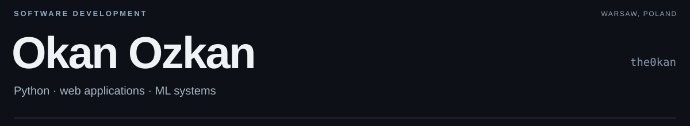

<picture>
  <source media="(prefers-color-scheme: dark)" srcset="assets/profile-dark-20261022.svg">
  <source media="(prefers-color-scheme: light)" srcset="assets/profile-light-20261022.svg">
  
</picture>

I study Computer Engineering at Vistula University in Warsaw, specializing in AI Engineering. I build web applications and use Python for machine learning experiments.

Selected participant in the **2026 Google Student AI Hackathon, Warsaw**, where I worked on TaskPilot's frontend in a team of five.

## Selected work

### [AdsForecast](https://github.com/the0kan/adsforecast)

An application for checking Meta Ads profitability after product costs, fees and advertising spend. My work covers API integration and contribution-margin calculations, with Supabase authentication, encrypted server-side storage for Meta access tokens and Playwright checks.

JavaScript · PostgreSQL · Supabase · Playwright

[Live app](https://adsforecast.com) · [Code](https://github.com/the0kan/adsforecast)

### [TaskPilot](https://github.com/iwosmu/Codeangers)

Frontend development for our five-person hackathon team. The app turns project briefs and CVs into task dependencies and owner suggestions; our working demo exported **one parent GitHub issue and 15 assigned sub-issues**.

React · TypeScript

[Code](https://github.com/iwosmu/Codeangers) · [Demo video](https://www.youtube.com/watch?v=rPXVT3FQx7k) · [Exported issues](https://github.com/iwosmu/Codeangers/issues/4)

### [Machine Learning Systems Lab](https://github.com/the0kan/machine-learning-lab)

Python coursework comparing Logistic Regression and Random Forest on the Breast Cancer Wisconsin dataset. I measured accuracy, training and inference time, model size and process memory using a fixed, stratified 70/30 train/test split. Logistic Regression reached **98.83% test accuracy**.

Python · scikit-learn

[Code and results](https://github.com/the0kan/machine-learning-lab/tree/main/lab01)

---

[LinkedIn](https://www.linkedin.com/in/theokan) · [Email](mailto:okanmsf@gmail.com) · Warsaw, Poland
