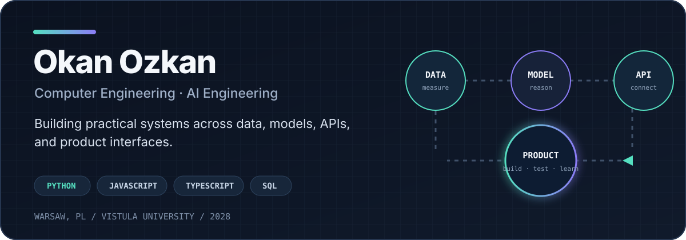

<picture>
  <source media="(prefers-color-scheme: dark)" srcset="assets/hero-dark.svg">
  <source media="(prefers-color-scheme: light)" srcset="assets/hero-light.svg">
  
</picture>

# Okan Ozkan

Computer Engineering student at Vistula University in Warsaw, specializing in AI Engineering.

Python is the language I reach for first. These days I spend most of my project time on web applications, APIs, and small machine learning systems. I also work with JavaScript, TypeScript, SQL, and React when the project calls for them.

## What I'm working on

### [AdsForecast](https://github.com/the0kan/adsforecast)

I'm building [AdsForecast](https://adsforecast.com) to answer a practical question for Meta advertisers: did a campaign make money after product costs, fees, and ad spend?

The app connects to the Meta Marketing API, calculates contribution margin and break-even ROAS, and keeps workspace data in Supabase and PostgreSQL. Authentication, provider keys, and OAuth tokens are handled behind Edge Functions. The repository also has CI and browser tests for the flows I don't want to break.

[Try it](https://adsforecast.com) · [Read the code](https://github.com/the0kan/adsforecast)

### [TaskPilot](https://github.com/iwosmu/Codeangers)

TaskPilot came out of the 2026 Google Student AI Hackathon in Warsaw. We were a team of five, and I built the React and TypeScript frontend.

Our prototype takes a project brief and team CVs, turns the work into a dependency graph, suggests an owner for each task, and exports the reviewed plan to GitHub. By demo time it could create a parent issue with 15 assigned sub-issues.

[Repository](https://github.com/iwosmu/Codeangers) · [Watch the demo](https://www.youtube.com/watch?v=rPXVT3FQx7k)

### [Machine Learning Systems Lab](https://github.com/the0kan/machine-learning-lab)

Not everything here is a product. This repo is where I'm documenting my ML systems coursework. The first lab compares Logistic Regression and Random Forest using a fixed 70/30 split, then measures accuracy, training time, inference time, model size, and memory use.

Logistic Regression reached **98.83% test accuracy**. The more useful lesson was that model quality was only part of the decision: deployment limits changed which model made sense.

## The short version

- Based in Warsaw, Poland
- Computer Engineering, AI Engineering specialization
- Expected graduation: 2028
- Most comfortable with Python
- Also use JavaScript, TypeScript, SQL, React, Supabase, PostgreSQL, Git, and Linux

## Find me elsewhere

[LinkedIn](https://www.linkedin.com/in/okanozkan-dev) · [Email](mailto:okanmsf@gmail.com) · [AdsForecast](https://adsforecast.com)
